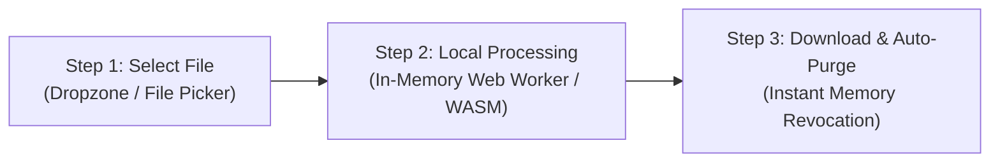
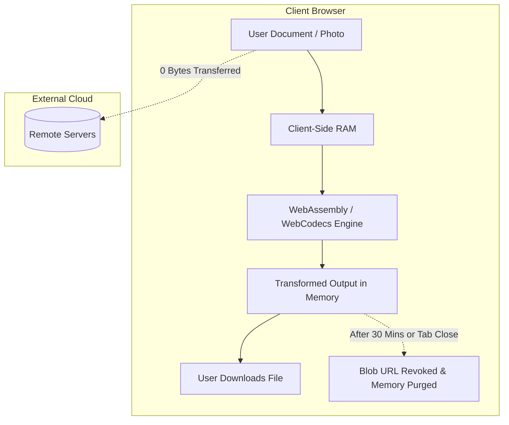
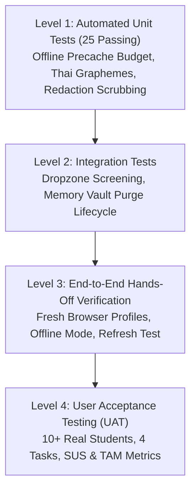

# UniLab Comprehensive Project Report

**Project Name:** UniLab — 100% Client-Side Academic Document Suite  
**Company:** Digital Imposters Pvt. Co., Ltd. (Company 18)  
**Course:** 1305493 Software Engineering Case Studies (Semester 1/2569)  
**Instructor:** Dr. Prasara Jakkaew (School of Information Technology, Mae Fah Luang University)  
**Live Production URL:** [https://unilab.ztvmm.live/](https://unilab.ztvmm.live/)  
**Coursework Preview URL:** [https://thiha-lynn.github.io/unilab/](https://thiha-lynn.github.io/unilab/)  
**Coursework Repository:** [https://github.com/Thiha-Lynn/unilab](https://github.com/Thiha-Lynn/unilab)  
**Date of Report:** 27 October 2026  

---

## Executive Summary

UniLab is a zero-telemetry, zero-upload, 100% client-side academic document processing suite engineered specifically for university students. Confronted with stringent Learning Management System (LMS) file size constraints, aggressive paywalls/watermarks on commercial web converters (e.g., iLovePDF, Smallpdf), and severe privacy risks when uploading identity documents (e.g., transcripts, ID cards, visas, petitions), students routinely face friction during high-stress deadline periods.

UniLab eliminates this entire class of problems through an uncompromising architectural invariant: **zero bytes of user files ever leave the local machine.** All file parsing, transformation, compression, redaction, encryption, and rendering execute entirely inside the client’s browser memory via WebAssembly and modern web APIs.

The project demonstrates end-to-end software engineering rigor:
- **Empirical Grounding:** Backed by 15 pre-midterm contextual inquiry interviews across 15 distinct MFU undergraduate degree programmes (`S1`–`S15`), uncovering 12 validated user pains (`P1`–`P12`).
- **Complete Traceability:** An unbroken chain connecting User Pains $\rightarrow$ Functional/Non-Functional/Legal Requirements (`F1`–`F15`, `NFR1`–`NFR7`, `LR1`–`LR8`) $\rightarrow$ Product Backlog Items (`B1`–`B35`) $\rightarrow$ Automated Test Suites.
- **Strict Course Alignment:** Full adherence to the five course guardrails, the Alpha Demo refresh/hands-off criteria, and the Post-Midterm Test Plan with a planned 10-user field testing protocol on 4 November 2026 utilizing the System Usability Scale (SUS) and Technology Acceptance Model (TAM).

---

## 1. Company Organization & Roles

UniLab was founded and built by Company 18 (**Digital Imposters Pvt. Co., Ltd.**):

| Name | Student ID | GitHub Handle | Primary Role | Core Responsibilities |
|---|---|---|---|---|
| **Myo Zin Thant** | `6631503079` | [`myo-zin-thant18`](https://github.com/myo-zin-thant18) | Product Owner | Requirements capture, backlog prioritization, stakeholder liaison, proposal ownership |
| **Thiha Lin** | `6631503092` | [`Thiha-Lynn`](https://github.com/Thiha-Lynn) | Tech Lead / Architect | Core architecture, pipeline engineering, CI/CD, security invariants |
| **Swan Htut Oakkar Aung** | `6631503088` | [`6631503088`](https://github.com/6631503088) | Designer / UX | Design system tokens, UI layout, mobile ergonomics, UAT test plan & instruments |
| **Zaw Win Htut** | `6631503084` | [`zawwinhuttt`](https://github.com/zawwinhuttt) | QA Lead / Tester | Test suite, automated regression verification, UAT data collection |
| **Team Member** | `6631503097` | [`6631503097`](https://github.com/6631503097) | Full-Stack Developer | Tool engine integration, media encoding, client-side workers |

---

## 2. Problem Statement & Empirical Evidence

### 2.1 The Core Student Dilemma
University students submit assignments, project portfolios, and administrative petitions late at night under strict deadlines, primarily using smartphones or budget laptops. When attempting to prepare these files, four systemic problems compound:

```
[Deadline Pressure (11 PM)]
           │
           ├──► Problem A: Commercial Free Tiers Ration at the Critical Moment (P1)
           │    (Watermarks, daily batch caps, paywalls encountered after work is completed)
           │
           ├──► Problem B: Inadvertent Surrender of Confidential Documents (P2)
           │    (ID cards, medical forms, transcripts uploaded to unknown remote servers)
           │
           ├──► Problem C: Fragmented Multi-App Workflow Chains (P6)
           │    (Hopping between 3 to 5 disparate apps and hopping between devices)
           │
           └──► Problem D: Blind Submissions & Hidden Failure Points (P7)
                (Uninformative "Upload failed" errors, wrong orientation, bloated file size)
```

### 2.2 Empirical Research: The 15-Interview Study
Rather than relying on synthetic assumptions or AI personas, the team conducted 15 semi-structured interviews between 22 August and 8 September 2026 across 15 distinct undergraduate majors at Mae Fah Luang University:

- **Participants:** 15 students (`S1` to `S15`).
- **Demographics:** Information Technology, Software Engineering, Multimedia, Business, English, Health Science, Applied Chemistry, Law, etc.
- **Language Breakdown:** English (9), Thai (4), Burmese (2).
- **Device Context:** 5 phone-only users, 7 started on phone and transferred to laptop.

### 2.3 The 12 Validated User Pains (`P1`–`P12`)
A hypothesis was only promoted to a verified pain if **at least two independent participants raised it unprompted**:

| Pain ID | Description | Participant Citations | Architectural Impact |
|---|---|---|---|
| **P1** | Free tier runs out / watermarks appear right before deadline | S1, S3, S9, S13 | `F2` (No accounts, no limits, no paywalls) |
| **P2** | Obligated to upload sensitive identity documents to untrusted cloud converters | S4, S7, S12, S14 | `F1`, `LR1`, `NFR1` (Zero server uploads; local execution) |
| **P3** | Long upload/download wait times on congested campus Wi-Fi | S2, S9, S10 | `F13`, `NFR3` (Offline PWA $\le 8$ MB precache) |
| **P4** | HEIC smartphone photos rejected by Moodle / web portals | S4, S13 | `F4` (Fast local HEIC $\rightarrow$ JPG conversion) |
| **P5** | Strict LMS / Moodle file upload ceilings (e.g., 5 MB or 10 MB) | S2, S10, S12, S15 | `F3` (Target-size compressor with quality slider) |
| **P6** | Multi-app fragmentation (competitors lack video/audio alongside docs) | S1, S3, S13, S14, S2, S9, S10 | `F9` (Integrated document, image, video, and audio tools) |
| **P7** | Limits discovered only after processing or upload fails | S1, S2, S4, S7, S9, S10, S13 | `F5`, `F14` (Real-time pre-run size and quality estimation) |
| **P8** | Merged sections in wrong order or broken page ranges | S8, S14 | `F10` (Visual reordering and preview before merge) |
| **P9** | Complex desktop software unsuited for quick mobile operations | S1, S6 | `F15` (Mobile touch-first responsive UI) |
| **P10** | Mobile browser crashes or freezes on large documents | S4, S7, S9, S11, S14, S15 | `F15`, `NFR4`, `NFR6` (Yielding web worker loops) |
| **P11** | Uncertainty over whether submitted files meet lecturer expectations | S2, S5, S15 | Explicit *Won't* boundary (LMS-side constraint) |
| **P12** | Office document conversion formatting fidelity issues | S3, S5, S8 | Explicit *Won't* boundary (Requires server LibreOffice) |

---

## 3. Product Scope & The "1 Core Workflow"

### 3.1 Course Guardrail 2 Compliance
Course Guardrail 2 stipulates: *"Buildable in 1 month — exactly 1 core workflow."*  
While UniLab offers 59 distinct utility settings, **UniLab has exactly 1 core workflow**:



All 59 specialized tools (Compress PDF, Merge PDF, Sign PDF, Crop Image, Trim Audio, Transcode Video, etc.) are **configuration settings of this single pipeline**, sharing identical UI primitives, dropzone screening, progress feedback, and retention logic.

### 3.2 In-Scope vs. Parked vs. Out-of-Scope (Won't) Boundaries

| Classification | Feature / Component | Justification |
|---|---|---|
| **In-Scope (Must)** | PDF Compress, Merge, Rotate, Split, Encrypt, Sign, Watermark | Directly solves validated student pains `P1`, `P2`, `P5`, `P8`. |
| **In-Scope (Must)** | HEIC Converter, Image Resizer/Cropper, Format Converter | Solves smartphone camera incompatibility (`P4`). |
| **In-Scope (Must)** | Audio Trim, Voice Recorder, Video Resize, WebCodecs Transcoder | Solves multi-app fragmentation for student presentations (`P6`). |
| **In-Scope (Must)** | 30-Minute Memory Vault with "Delete Now" Button | Enforces PDPA retention and data minimization (`LR5`, `NFR2`). |
| **Parked (Q5/Q6)** | Thai/Burmese OCR (`F8`) & Chained Workflows (`F11`) | 0 of 15 interviewees requested them unprompted; parked to maintain scope discipline. |
| **Out-of-Scope (Won't)** | User Accounts, Cloud Storage, Server Database | Violates zero-upload privacy guarantee (`LR1`, `LR2`). |
| **Out-of-Scope (Won't)** | Flawless PDF-to-Word Re-flow (`P12`) | Requires heavy server-side engines; violates client-only constraint. |

---

## 4. Legal Compliance & Privacy Architecture

UniLab's legal compliance is **architectural, not contractual**:



1. **Personal Data Protection Act (PDPA):**
   - Because no files or personal identifiers are collected, transmitted, or stored on external servers, UniLab requires no intrusive cookie banners or consent check-boxes (`LR1`, `LR2`).
   - Results exist exclusively as temporary in-memory Object URLs that expire automatically after 30 minutes or immediately upon clicking *"Delete Now"* or closing the tab (`LR5`).
2. **Computer Crimes Act (CCA) Section 26:**
   - UniLab operates as client software rather than a service provider storing third-party subscriber data. Thus, mandatory server log retention burdens do not apply.
3. **Electronic Transactions Act (ETA) Sections 9, 26, 28:**
   - Handwritten digital signatures (`F7`) generate clean client-side SVG vectors stamped directly onto the PDF DOM coordinate space, satisfying electronic signature enforceability standards.

---

## 5. Technical Architecture & Implementation

### 5.1 Tech Stack
- **Build System & Runtime:** Vanilla JavaScript (ES2022+), Vite 8.2.1 (Fast, zero-framework overhead).
- **PDF Manipulation:** `pdf-lib` (Document generation, page manipulation, encryption, vector stamping), `pdf.js` (High-fidelity browser rendering).
- **Media Processing:** `mediabunny` (Modern WebCodecs API for high-performance in-browser video/audio demuxing and decoding).
- **Image Processing:** `cropperjs`, `browser-image-compression`, `heic2any` (Client-side libheif WebAssembly wrapper).
- **Document Conversion:** `mammoth.js` (.docx to HTML/PDF conversion), `jszip` (Batch packaging).
- **Progressive Web App (PWA):** Custom Service Worker precaching core assets within an **$\le 8\text{ MB}$ strict offline budget** (Current build: 7.41 MB).

### 5.2 Performance & Memory Guardrails
- **Loop Non-Blocking:** CPU-heavy loops yield execution via `setTimeout(0)` rather than `requestAnimationFrame`, preventing UI freezes even during heavy 100-page document tasks (`NFR6`).
- **Grapheme Cluster Awareness:** Uses `Intl.Segmenter` for accurate character and page counting, avoiding broken Thai diacritics and combining vowels (`NFR7`).
- **Zero-Byte File Leaks:** FileReader objects and ArrayBuffers are dereferenced immediately after canvas or PDF-lib operations to ensure prompt garbage collection on mobile devices with limited RAM.

---

## 6. Verification & Testing Pyramid

UniLab employs a multi-tiered testing strategy ensuring both code stability and usability validation:



### 6.1 Automated Test Suite (`npm test`)
UniLab maintains 25 automated unit and regression tests running in Node.js:
- `offline budget`: Enforces release bundles strictly stay within the 8 MB precache limit.
- `graphemes()`: Tests adversarial Thai combining character sequences.
- `lecture sanitization`: Validates that external scripts and CSS network references are stripped.
- `dropzone screening`: Ensures unsupported filetypes or oversized drops fail with clear error messages.
- `redaction byte scrub`: Validates that redacted regions are destroyed at the byte level rather than visually overlaid.
- `memory vault countdown`: Validates that timer expiration purges files from memory without user interaction.

### 6.2 Post-Midterm UAT & Field Testing Plan (4 November 2026)
Following course requirements (`Post-Midterm-Plan-2569-EN.pdf`):
- **Participants:** $\ge 10$ MFU students (`U01` to `U10`) across two iterative waves (Nielsen 5+5 model: 5 morning, triage sprint, 5 afternoon).
- **Evaluation Tasks:**
  1. *Task 1 (Slides):* Compress 15 MB slide deck under 5 MB, rotate upside-down pages, convert to B&W.
  2. *Task 2 (Merge):* Combine application form PDF, IELTS JPG, and Thai ID PNG into one ordered PDF.
  3. *Task 3 (Sign):* Draw signature on academic petition and encrypt with password `UniLabSecure2026`.
  4. *Task 4 (Split):* Extract single page 42 from a 120-page textbook.
- **Quantitative Target Metrics:**
  - **Task Success Rate:** $100\%$ hands-off completion without facilitator intervention.
  - **System Usability Scale (SUS):** Benchmark $\ge 80.8$ (Grade A / Excellent; industry average is 68.0).
  - **Technology Acceptance Model (TAM):** Benchmark $\ge 4.0 / 5.0$ across Perceived Usefulness (PU), Perceived Ease of Use (PEOU), and Behavioral Intention (BI).

---

## 7. Project History & Key Milestones

| Timeline | Phase / Gate | Milestone Deliverables |
|---|---|---|
| **Week 1 (Aug 2026)** | Foundation | Company Charter established (Company 18); 1 Core Workflow defined. |
| **Week 2 (Aug 2026)** | Legal Architecture | `rule.md` drafted; derived 8 Legal Requirements (`LR1`–`LR8`) from Thai PDPA, CCA §26, and ETA. |
| **Week 3 (Sep 2026)** | Specification | Formal Software Requirements Specification (`01-spec`) and Product Backlog (`backlog.md`). |
| **Week 4 (Sep 2026)** | Design Pack | Design system, clickable prototype, and 4 formal UML/C4 diagrams (D1–D4). |
| **Week 5 (Sep 2026)** | Validation Gate | Completed 15 real-user interviews across 15 majors; validated 12 user pains (`P1`–`P12`); parked OCR and Workflows. |
| **Week 6–10 (Oct 2026)**| Midterm & Alpha | Core tools implemented; 25 automated tests; Alpha Demo verified live refresh and hands-off tests. |
| **Week 11 (27 Oct 2026)**| Test Plan Due | Authored formal Test Plan deliverable; created UAT Kit, Scorecards, and Metric Calculator ([PR #20](https://github.com/Thiha-Lynn/unilab/pull/20), [PR #21](https://github.com/Thiha-Lynn/unilab/pull/21)). |
| **Week 12 (4 Nov 2026)** | Field Testing Day | Execute 10+ real-student UAT sessions on MFU campus using Nielsen 5+5 iterative method. |
| **Week 14 (18 Nov 2026)**| Final Presentation | Final 100-point course presentation and defense for Team 18. |

---

## 8. Summary Table of Key Links & References

| Resource | Path / URL |
|---|---|
| **Live Web App** | [unilab.ztvmm.live](https://unilab.ztvmm.live/) |
| **Coursework Repository** | [github.com/Thiha-Lynn/unilab](https://github.com/Thiha-Lynn/unilab) |
| **Full Traceability Matrix** | [`.docs/01-requirements/TRACEABILITY.md`](.docs/01-requirements/TRACEABILITY.md) |
| **Core Requirements Spec** | [`.docs/01-requirements/01-spec/20260826-01-unilab-core.md`](.docs/01-requirements/01-spec/20260826-01-unilab-core.md) |
| **15-Interview Results** | [`.docs/01-requirements/02-interviews/results.md`](.docs/01-requirements/02-interviews/results.md) |
| **Post-Midterm Test Plan** | [`.docs/04-test/test-plan.md`](.docs/04-test/test-plan.md) |
| **UAT Field Protocol & Kit**| [`.docs/04-test/uat-protocol-and-questionnaire.md`](.docs/04-test/uat-protocol-and-questionnaire.md) |
| **UAT Scorecard CSV** | [`.docs/04-test/uat-scorecard-template.csv`](.docs/04-test/uat-scorecard-template.csv) |
| **Metrics Calculator** | [`.docs/04-test/calc-metrics.py`](.docs/04-test/calc-metrics.py) |
