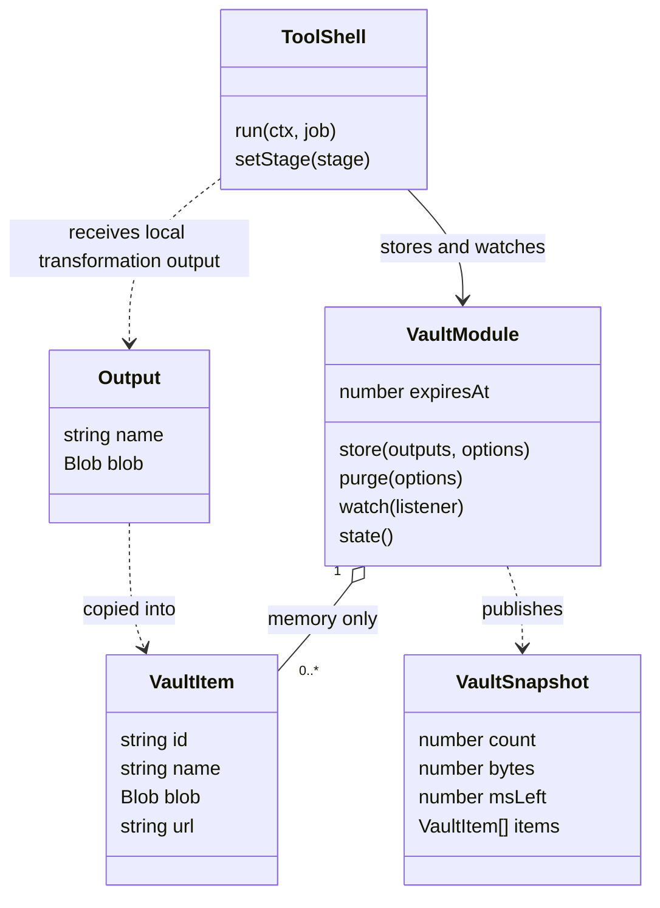

# Core sequence and data model

Reviewed against coursework `src/tool-shell.js` and `src/vault.js` on the consolidated review branch. These describe the shared shell/vault path, not every legacy tool or the production analytics service. The existing [architecture/use-case/activity pack](../02-design/diagrams.md) remains linked separately.

## Sequence: select, process, save, purge

```mermaid
sequenceDiagram
    actor Student
    participant Shell as Tool shell
    participant Intake as File screening
    participant Tool as Local transformation
    participant Vault as In-memory vault
    participant Browser as Browser download
    Student->>Shell: Select or drop files
    Shell->>Intake: screenFiles(files)
    alt Rejected file
        Intake-->>Shell: Rejection reason
        Shell-->>Student: Explain type/size limit
    else Accepted
        Intake-->>Shell: Accepted files
        Student->>Shell: Choose options and run
        Shell->>Tool: run(ctx, signal)
        alt Failure or cancellation
            Tool-->>Shell: Error/cancel
            Shell-->>Student: Status and recovery
        else Outputs produced
            Tool-->>Shell: outputs with names and blobs
            Shell->>Vault: store(outputs, ttlMinutes)
            Vault->>Vault: Purge previous job; create object URLs
            Vault-->>Shell: Stored results and countdown
            Student->>Shell: Download
            Shell->>Browser: Local blob download
            Browser-->>Student: Save under user's control
            Note over Vault,Browser: Vault expiry does not delete user's downloaded copy
            Student->>Shell: Clear, or expiry/pagehide occurs
            Shell->>Vault: purge (clear action)
            Note over Vault: Expiry/pagehide also invokes purge directly
            Vault->>Vault: Revoke URLs; clear blob references
        end
    end
```

## Class-style data model (JavaScript records/modules, not database tables)



Sources: [shell](../../src/tool-shell.js), [vault](../../src/vault.js), [intake](../../src/intake.js). Production signing may specify a shorter TTL. The diagrams do not assert identity persistence, a database or uploading file contents.
